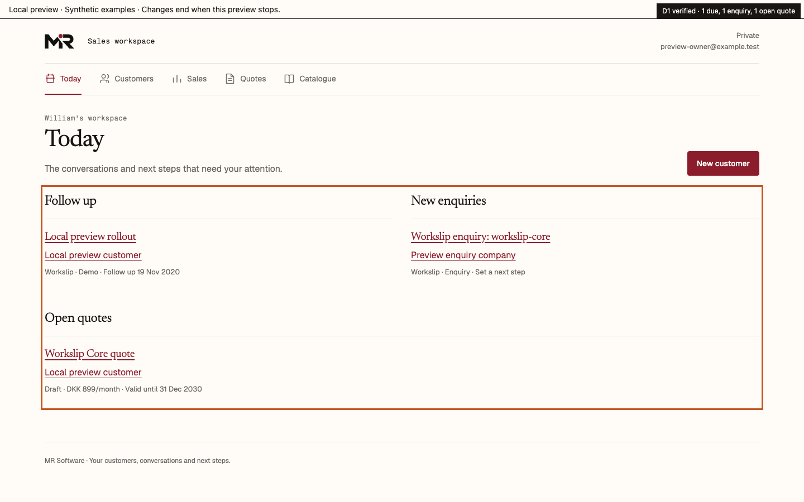
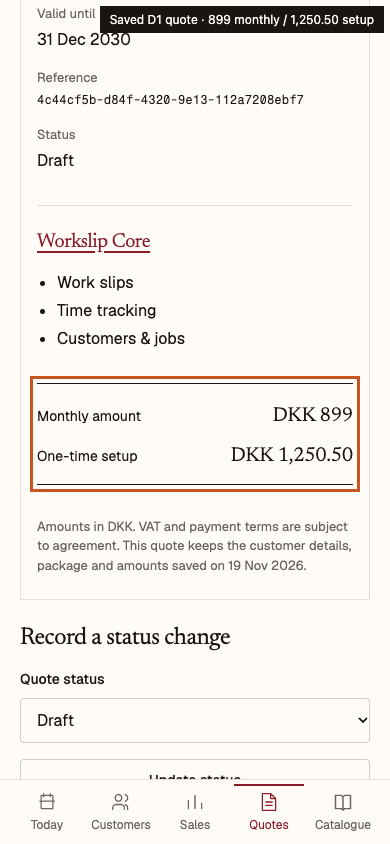

# Commercial sales QA — 19 November 2026

Tracking: [SAS-561](https://linear.app/workslip/issue/SAS-561/offer-public-qrpwa-demos-and-williams-sales-backoffice).

The integrated company entrypoints, public demos/pricing and private sales
workspace passed desktop and phone browser checks. The highlighted captures below
use Chromium at **1440 × 900** and **390 × 844**, compiled application assets and
an ephemeral **real local D1** database. All names, contacts and sales records are
synthetic. Orange outlines and black annotations identify the checked result;
they were added to the live page before capture.

## Results checked against source and storage

The public catalogue API was compared with `commercial/shared/catalog.mjs`,
then its values were compared with the rendered prices. The public enquiry was
submitted through the actual phone form. Private counts and saved quote amounts
were checked through the authenticated API and direct D1 reads. The complete
machine-readable results are in [evidence.json](evidence.json).

| Check | Source / stored result | Visible result |
| --- | --- | --- |
| Public demos | 3 active demos | Workslip, Tradey and Shippy; direct seeded records |
| Packages | 5 | 3 priced Workslip packages and 2 agreed-price packages |
| Workslip monthly prices | 89,900 / 189,600 / 244,400 minor units | DKK 899 / DKK 1,896 / DKK 2,444 |
| Tradey / Shippy prices | `null` | “Let’s agree a price” |
| One submitted enquiry | 1 enquiry; 2 customers, 2 opportunities including the preview seed | Receipt reference appears above the form; Today shows the new enquiry |
| Today | 1 due follow-up, 1 new enquiry, 1 open quote | All three sections display the matching synthetic records |
| Saved draft quote | 89,900 monthly; 125,050 setup minor units | DKK 899 monthly; DKK 1,250.50 setup |
| Quote snapshot | “Local preview customer”, draft | Matching saved customer and status |
| Horizontal overflow | 0 px in all 10 captures | No sideways scrolling at either viewport |

## Highlighted views

| Flow | Desktop | Phone |
| --- | --- | --- |
| Company homepage: managed demo / pricing links | [Homepage](company-desktop.png) | [Homepage](company-phone.png) |
| Public directory: direct example entry | [Directory](directory-desktop.png) | [Directory](directory-phone.png) |
| Prices and enquiry receipt | [Prices](pricing-desktop.png) | [Submitted enquiry](enquiry-phone.png) |
| Private first screen: due work, enquiries and quotes | [Today](today-desktop.png) | [Today](today-phone.png) |
| Quote amounts from the saved D1 record | [Quote](quote-desktop.png) | [Quote, scrolled to amounts](quote-phone.png) |

## Verification and review boundary

The final `npm test` passed with **101 Node tests**, **2 upstream link-editor
browser tests**, **119 company/dashboard browser tests** and **112 integrated
commercial browser tests**. The company suite retains 21 intentional skips;
there are no new commercial skips or raised click budgets. All three shared UX
gate copies match the installed template byte-for-byte. The full runner builds
once and runs each gate once, with inherited color conflicts normalized.

Production-boundary tests execute the actual Wrangler dry-run Worker bundle,
compiled assets and default signed Access verifier in Miniflare. They cover
authenticated private-root entry, unauthenticated denial, invalid identities and
private assets denied on public/unknown hosts. Actual Wrangler 4.153.0 upload
manifests contain 46 public company files and 53 compiled commercial files;
commercial source, private seeds, internal evidence and configuration are absent
from the corresponding public uploads. The manifest adapter is intentionally
version-pinned because it uses an internal Wrangler helper.

`npm run preview:commercial` prints working loopback URLs for the directory,
prices and private Today. The local identity is isolated in that executable and
every page is visibly synthetic. Company-site entrypoints redirect to the
future owned `demos.mrsoftware.dk` hostname; that redirect contract is browser
tested, but those links are **not a deployed preview**. Use the printed loopback
URLs to review the commercial app now. See the
[release guide](../../operations/commercial-release.md) for the fail-closed
resource checks and enforced commercial-before-company release order.

No production resources, policies, DNS, migrations or deployments were changed.
Physical iPhone/Android hardware, Safari, native installation prompts, physical
camera scanning and system print/PDF destinations remain unverified. Browser
offline/update/QR/print tests are automated evidence for their scoped behavior,
not a claim of physical-device coverage.
